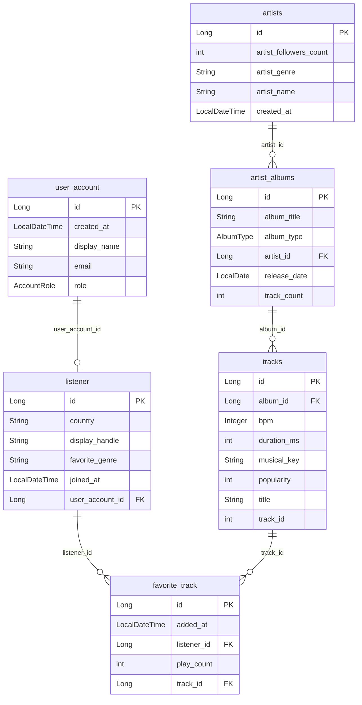

# Schemat bazy danych

Plik generują reguły projektu (panel Maven → Lifecycle → verify). Nie edytujcie go ręcznie.

Tabele: 6 · kolumny: 35 · relacje: 4 × @ManyToOne, 1 × @OneToMany, 1 × @OneToOne, 0 × @ManyToMany

| Tabela | Encja | Kolumny | Klucze obce |
|---|---|---|---|
| artist_albums | ArtistAlbums | 6 | artist_id |
| artists | Artists | 5 | — |
| favorite_track | FavoriteTrack | 5 | listener_id, track_id |
| listener | Listener | 6 | user_account_id |
| tracks | Tracks | 8 | album_id |
| user_account | UserAccount | 5 | — |

